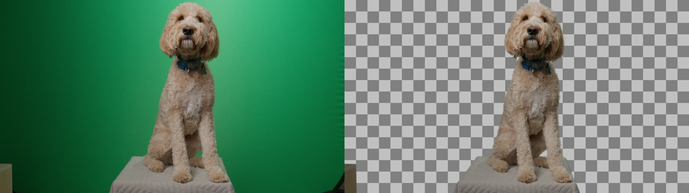

# CorridorKey 2 for Resolve — Intel Mac + AMD Radeon

**Corridor Digital's AI green-screen keyer in DaVinci Resolve, on Intel Macs with an AMD Radeon GPU.** An OpenFX plugin for Resolve's Fusion and Edit pages and Fusion Studio that keys green and blue screens with [CorridorKey 2.0](https://github.com/nikopueringer/CorridorKey2.0) by Corridor Digital. Hair, fur, motion blur and uneven screens key cleanly with no keyer settings, and a rough garbage matte on its Hint input removes anything outside the screen.

By KolorKlinic. Free and unofficial: not made or endorsed by Corridor Digital or Blackmagic Design.

## Is it for you?

- **Intel Mac with an AMD Radeon GPU.** Tested on a Radeon RX 6700 XT (12 GB). Other Radeon cards should work; cards with less memory key fewer frames at once. Intel integrated graphics is untested.
- **64 GB of memory recommended.** The GPU can use up to 1.7× its own memory, with the rest in system RAM.
- **macOS 14 (Sonoma) or later.**
- **About 7 GB of disk** for CorridorKey and its Python, plus about 2.5 MB for each processed HD frame.
- **Resolve Studio or Fusion Studio.**

## Install

1. Quit Resolve and Fusion Studio.
2. Download the zip from [Releases](../../releases), unzip it and copy `CorridorKey2.ofx.bundle` into `/Library/OFX/Plugins` (macOS asks for your password). The bundle isn't notarized by Apple; if macOS blocks it, run `sudo xattr -dr com.apple.quarantine /Library/OFX/Plugins/CorridorKey2.ofx.bundle`.
3. Start Resolve, add **Effects > OpenFX > KolorKlinic > CorridorKey 2** to a clip, open the node's **Setup** section and press **Install Model**. Terminal opens, asks you to accept the CorridorKey licence, then downloads CorridorKey 2.0's code from Corridor's GitHub and its weights from Hugging Face (about 5 GB), checks every file against the tested version, and loads the model once on the GPU. You do this once per Mac.

No account or token is needed.

## Using it

Put CorridorKey 2 after your clip and press **Process**. A progress window shows the frame, the chunk and the time left; Status says the same in the Inspector. The node then draws from the stored results, so playback is instant and **Output** and **Despill** change live.

- **Input Is:** Rec.709 for most timelines, sRGB Linear for linear footage, ACEScg for CG renders (the output stays in ACEScg).
- **Temporal Chunks:** how many frames CorridorKey keys together. Auto picks the most the GPU's memory allows (4 at HD on a 12 GB card); Status reports what it used.
- **Output:** Premultiplied, Matte Only, Unpremultiplied (the cleaned foreground with the matte as alpha), or Source + Matte (Unpremultiplied) (your untouched picture with the matte as alpha).
- **Hint:** a rough matte of the subject (a rectangle, Magic Mask or roto) on the Hint input, or in the source's alpha on the Edit page. At a strength of 0.3 to 0.5 it removes anything outside it and keeps CorridorKey's own edges.
- **Frames that aren't processed** show the picture with a red frame and **NOT PROCESSED - PRESS PROCESS** across the middle; a yellow frame and **PICTURE CHANGED - PRESS PROCESS AGAIN** mean the picture changed since Process. Scrub once before you deliver.
- **Edit page:** after Process, move the playhead once to see the result.

## Speed

About **10.5 seconds per HD frame** on a Radeon RX 6700 XT (i9-11900KF, 64 GB), plus about 15 seconds to load the model. A 10-second clip at 24 fps takes about 40 minutes, so try a short **Range** first.

## How it runs on AMD

CorridorKey 2.0 is written for NVIDIA GPUs. The worker (`worker/`) runs it unmodified from `~/CorridorKey` and redirects its CUDA calls to the GPU through Metal (PyTorch's MPS backend). Intel Macs need PyTorch 2.2.2, the last PyTorch for them, so `worker/ck2_mps.py` fills in what that version lacks on AMD GPUs:

- `F.rms_norm` and `nn.RMSNorm` (PyTorch 2.4+)
- fp32 throughout: no bfloat16 or autocast on AMD
- attention computed in slices of queries, because AMD GPUs cap a single buffer at a few GB (same result)
- bicubic resizes on the CPU

## What's where

| | |
|---|---|
| `/Library/OFX/Plugins/CorridorKey2.ofx.bundle` | the plugin |
| `~/CorridorKey` | CorridorKey 2.0, its weights and its Python (Install Model) |
| `~/.cache/cvt-corridorkey2` | stored results and logs (the node's Cache Folder can move the results to any drive, a shared one included) |

To uninstall, delete those three.

## Building from source

You need the Xcode Command Line Tools, cmake and [uv](https://github.com/astral-sh/uv) on your PATH. `./build.sh` builds OpenEXR and Imath once (pinned and checksummed), then the plugin for x86_64 into `build/CorridorKey2.ofx.bundle`, and runs the tests. `./install.sh` copies it into `/Library/OFX/Plugins`.

## Credits and licence

Based on [CorridorKey 2 for Resolve](https://github.com/creativevideotips/cvt-corridorkey2) by Creative Video Tips, adapted for Intel Macs and AMD GPUs. The CorridorKey keyer and its weights are by Corridor Digital.

Licensed under CC BY-NC-SA 4.0 with the CorridorKey additional terms; see [LICENSE](LICENSE). It is free and must stay free. CorridorKey 2.0 and its weights are downloaded from Corridor Digital's own pages under their licence. Organisations with more than US $20 million in annual revenue need a CorridorKey seat for each user from [corridorkey.com](https://corridorkey.com). The components included in the plugin, and the models CorridorKey uses, are listed in [THIRD_PARTY_NOTICES.md](THIRD_PARTY_NOTICES.md).
